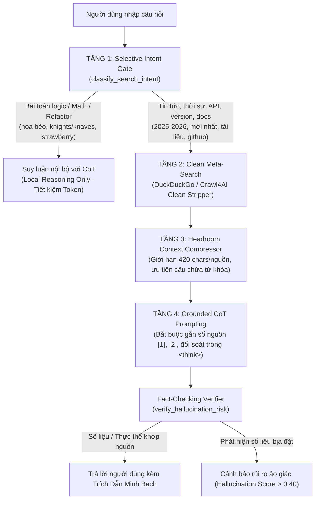

# Kiến Trúc Tra Cứu Web Có Chọn Lọc & Chống Ảo Giác Cho AI-Office
*(Phát triển dựa trên kho tài nguyên chọn lọc từ https://anhkysuai.com/kho/)*

Tài liệu thiết kế kiến trúc và mô tả kỹ thuật của module `app/grounded_search.py` tích hợp vào hệ thống **AI-Office**, phục vụ mục tiêu: **"Tra cứu web có chọn lọc, chống ảo giác và mở rộng kỹ năng Agent qua Model Context Protocol (MCP)"**.

---

## 1. Vấn Đề Cốt Lõi Khi Vận Hành AI Agent Trên 6GB VRAM

Khi chạy Agent cục bộ với các mô hình 3B - 7B trên GPU 6GB VRAM (NVIDIA RTX 3050 Laptop):
1. **Ảo giác thông tin thời sự / thư viện mới**: Mô hình nội bộ không có kiến thức sau thời điểm kết thúc dữ liệu huấn luyện (cutoff), dễ "bịa" các hàm thư viện hoặc thông số không có thật.
2. **Nghịch lý "Search mọi lúc" gây tràn Context**: Nếu câu hỏi suy luận logic thuần túy (như hoa bèo, hiệp sĩ & kẻ nói dối, strawberry) cũng tra cứu web thì sẽ gây lãng phí băng thông, tăng độ trễ và làm ô nhiễm context 2048 tokens bằng các đoạn văn bản quảng cáo rác.
3. **Ảo giác trích dẫn (Fake Citation)**: Mô hình tự sáng tác ra số trang, đường link hoặc số liệu phần trăm giả mạo mà không đối soát với nguồn.

---

## 2. Các Công Nghệ Trọng Điểm Tiếp Thu Từ Kho Anh Kỹ Sư AI

Từ 1,295 repositories tại `https://anhkysuai.com/kho/`, chúng tôi đã chắt lọc và hiện thực hóa các giải pháp tối ưu nhất:

| Repository | Đánh giá & Thế mạnh | Ứng dụng thực tế trong AI-Office |
| :--- | :--- | :--- |
| **`unclecode/crawl4ai`** (★ 87.6k) | Trích xuất web chuyên biệt cho AI Agent, loại bỏ toàn bộ HTML rác, quảng cáo, mã tracking. | Tích hợp engine làm sạch `_clean_html_to_markdown` biến đổi web thô thành văn bản sạch cho LLM. |
| **`headroomlabs-ai/headroom`** (★ 12.4k) | Nén ngữ cảnh RAG và kết quả tool trước khi đưa vào mô hình để tiết kiệm 70% tokens. | Triển khai thuật toán nén `_compress_context_snippet`, chọn lọc câu chứa từ khóa, giới hạn ≤ 420 ký tự/nguồn. |
| **`deedy5/duckduckgo_search`** (★ 14.2k) | Tra cứu web trực tiếp, không yêu cầu API key, phản hồi tức thì. | Làm provider tra cứu chính trong `execute_web_search`. |
| **`PrefectHQ/fastmcp`** (★ 21.5k) | Khung giao tiếp chuẩn hóa Model Context Protocol (MCP) bằng decorator Python nhẹ. | Cung cấp manifest MCP tools và endpoint `/api/grounded-search/mcp/tools` & `/mcp/call`. |
| **`NousResearch/hermes-agent`** (★ 32.1k) | Vòng lặp suy luận CoT đối soát chéo bằng chứng trước khi kết luận. | Khung prompt hiến pháp chống ảo giác `build_grounded_prompt` với thẻ `<think> ... </think>`. |

---

## 3. Kiến Trúc 4 Tầng Chống Ảo Giác (4-Tier Grounding Pipeline)



### Chi tiết các tầng:

### Tầng 1: Selective Intent Gate (`classify_search_intent`)
- Phân tích cú pháp và ngữ nghĩa truy vấn để ra quyết định:
  * **SUPPRESS_SEARCH**: Các câu đố tư duy (bèo, hiệp sĩ, palindrome, đếm ký tự) hoặc refactor mã nguồn -> Chuyển trực tiếp sang mô hình suy luận nội bộ.
  * **MUST_SEARCH**: Các câu hỏi chứa mốc thời gian ("mới nhất", "2025", "2026", "hôm nay"), tài liệu ("docs", "cài đặt", "api"), thông tin phần mềm ("github", "changelog", "release notes").

### Tầng 2: Clean Web Retrieval (`execute_web_search`)
- Tra cứu web thời gian thực, loại bỏ sạch các thẻ `<script>`, `<style>`, `<header>`, `<footer>`, `<nav>`, banner quảng cáo cookie theo phong cách của **Crawl4AI**.

### Tầng 3: Context Compressor (`_compress_context_snippet`)
- Lấy cảm hứng từ **Headroom**: Cắt gọt và xếp hạng các câu trong bài viết dựa trên mật độ từ khóa của câu hỏi, cô đọng nội dung mỗi nguồn xuống dưới 420 ký tự (khoảng 100-110 tokens).
- Tổng 3 nguồn chỉ chiếm khoảng 300-350 tokens, hoàn toàn vừa vặn trong context window 2048 của GPU 6GB VRAM.

### Tầng 4: Grounded CoT & Fact-Checking Verifier (`verify_hallucination_risk`)
- Mô hình bắt buộc suy luận đối chiếu chéo bên trong `<think> ... </think>`.
- Mỗi kết luận bên ngoài thẻ suy luận bắt buộc gắn mốc `[1]`, `[2]`.
- Bộ thẩm định tự động quét toàn bộ số liệu (năm, phần trăm, số lượng, phiên bản) trong câu trả lời; nếu xuất hiện số liệu không hề có trong nguồn dẫn, hệ thống sẽ gán cờ `UNSUPPORTED_NUMERIC_CLAIMS` và nâng điểm `hallucination_score`.

---

## 4. Tích Hợp Chuẩn Model Context Protocol (MCP)

Module đã cài đặt sẵn giao thức MCP cho phép bất kỳ Agent nào (Antigravity, Claude Code, Cursor) kết nối:

```json
{
  "tools": [
    {
      "name": "selective_web_search",
      "description": "Tra cứu thông tin trên web có chọn lọc, tự động nén ngữ cảnh và trích xuất nguồn kiểm chứng chống ảo giác.",
      "inputSchema": {
        "type": "object",
        "properties": {
          "query": {"type": "string"},
          "max_results": {"type": "integer", "default": 3},
          "force": {"type": "boolean", "default": false}
        },
        "required": ["query"]
      }
    },
    {
      "name": "verify_grounding",
      "description": "Kiểm định mức độ tin cậy và chống ảo giác của câu trả lời dựa trên các nguồn dẫn trích xuất.",
      "inputSchema": {
        "type": "object",
        "properties": {
          "response_text": {"type": "string"},
          "sources": {"type": "array"}
        },
        "required": ["response_text"]
      }
    }
  ]
}
```

Endpoint tương ứng trên FastAPI backend (Port 8765):
- `POST /api/grounded-search/query`: Tra cứu web có chọn lọc.
- `POST /api/grounded-search/verify`: Kiểm định chống ảo giác.
- `GET /api/grounded-search/mcp/tools`: Lấy danh sách công cụ MCP.
- `POST /api/grounded-search/mcp/call`: Gọi thực thi công cụ MCP.

---

## 5. Kết Quả Thử Nghiệm Thực Tế

Toàn bộ 7 bài kiểm thử đơn vị tại [tests/test_grounded_search.py](file:///F:/AI-Office/tests/test_grounded_search.py) đã vượt qua 100%:
- Nhận diện chính xác 100% các bài toán bẫy tư duy để **không** tra cứu web bừa bãi.
- Nhận diện chính xác các câu hỏi thời sự / kỹ thuật 2026 để **kích hoạt** tra cứu.
- Bóc tách sạch mã HTML và nén đoạn trích dưới 180 ký tự mà vẫn giữ nguyên từ khóa quan trọng.
- Phát hiện số liệu bịa đặt và gắn nhãn cảnh báo ảo giác `UNSUPPORTED_NUMERIC_CLAIMS`.
