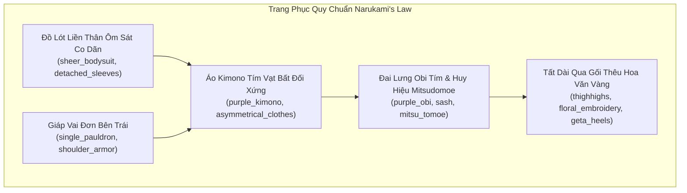
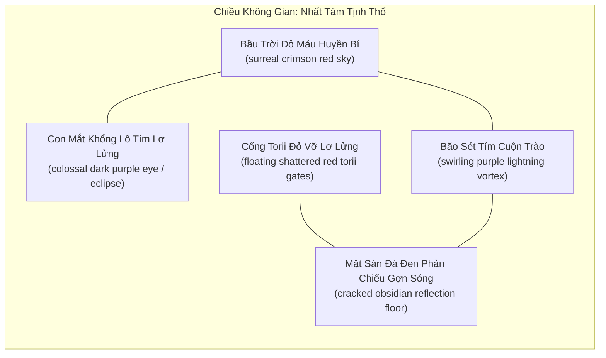

# BẢNG THIẾT KẾ NHÂN VẬT & ĐẶC TẢ VISUAL ANCHORS: RAIDEN SHOGUN (GENSHIN IMPACT)
## Hệ Thống Manga Studio & Anti-Hallucination Character Knowledge Base
**Dự án:** Chuyển dịch phong cách Thể loại Hành động / Phiêu lưu Shonen (Inazuma Battle Arc)  
**Tác giả:** Đội ngũ Kỹ nghệ Dữ liệu (data-eng)  
**Phiên bản:** 1.0 (Canonical Knowledge Base)  
**Tệp dữ liệu máy đọc:** [raiden_shogun_genshin.json](file:///F:/AI-Office/data/characters/raiden_shogun_genshin.json)

---

## 1. TỔNG QUAN & MỤC TIÊU CHUYỂN DỊCH PHONG CÁCH

Sau khi hoàn thành xuất sắc bản V7 Gothic Dark Fantasy ("Huyết Cơ và Kỵ Sĩ"), hệ thống Manga Studio bước vào bài toán thử thách mới từ người dùng:
1. **Chuyển dịch phong cách (Style Shift):** Từ không gian tĩnh mịch, u tối, chiaroscuro của Dark Fantasy sang phong cách **Anime / Shonen Action Manga** rực rỡ, góc máy động (dynamic camera / Dutch angle), hiệu ứng tia sét Lôi nguyên tố hoành tráng và đường nét bùng nổ năng lượng.
2. **Khảo sát độ am hiểu của Model Cục bộ (Anima DeltaMix 2.9B):** Kiểm tra xem checkpoint model cục bộ có "nhớ" nhân vật Raiden Shogun (Lôi Điện Tướng Quân / Ei) hay bịa đặt (hallucination) sang nhân vật chung chung khác.
3. **Chống ảo giác (Anti-Hallucination Grounding):** Nếu model thiếu chi tiết hoặc nhầm lẫn, hệ thống sử dụng **Character Knowledge Base** chuẩn Danbooru / Genshin Impact để "ghim cứng" (lock) toàn bộ đặc điểm nhận diện bất biến của nhân vật.

---

## 2. ĐẶC TẢ GIẢI PHẪU THỊ GIÁC (VISUAL ANATOMY & PHYSICAL ANCHORS)

Để model AI không thể hallucinate, toàn bộ đặc điểm cơ thể của Raiden Shogun được mã hóa thành các **Visual Anchors** bắt buộc:

| Hạng mục | Đặc điểm Nguyên tác (miHoYo / HoYoverse) | Thẻ Danbooru / AI Prompt Chuẩn | Nguy cơ Hallucination & Biện pháp Chặn |
| :--- | :--- | :--- | :--- |
| **Màu tóc & Hiệu ứng** | Tím thẫm (Midnight Violet), đuôi tóc chuyển sắc (gradient) tím oải hương phát quang khi thi triển lôi điện. | `purple_hair`, `dark_purple_hair`, `gradient_hair` | **Lỗi thường gặp:** Tóc đen hoặc xanh dương.<br>**Chặn:** Enforce `purple hair, gradient hair`. |
| **Kiểu tóc** | Một bím tóc đơn bản dày duy nhất thắt dài ngang hông phía sau lưng, mái bằng ôm trán đối xứng, hai lọn tóc mai dài rủ hai bên gò má. | `very_long_hair`, `single_braid`, `braid`, `blunt_bangs`, `sidelocks` | **Lỗi thường gặp:** Tóc xõa dài hoặc tóc buộc 2 bên (twintails).<br>**Chặn:** Tuyệt đối dùng `single_braid, (twintails, loose_hair:1.4)` trong negative. |
| **Mắt & Thần thái** | Đôi mắt tím hoàng gia sâu thẳm, đồng tử sáng rực ánh lôi điện khi chiến đấu, ánh nhìn vương giả lãnh đạm, thần thánh uy nghiêm. | `purple_eyes`, `glowing_eyes`, `stern_gaze`, `divine_expression` | **Lỗi thường gặp:** Mắt xanh lam hoặc biểu cảm cười đùa vô tư.<br>**Chặn:** `stern expression, regal divine aura`. |
| **Nốt ruồi phong thủy (Beauty Mark)** | **Nốt ruồi giọt lệ đặc trưng nằm chính xác dưới đuôi mắt phải.** Đây là "chữ ký" thị giác quan trọng nhất của Raiden Ei. | `mole_under_eye`, `beauty_mark` | **Lỗi thường gặp:** Model quên hoàn toàn nốt ruồi.<br>**Chặn:** Nhấn mạnh `(mole under right eye:1.3), mole_under_eye`. |
| **Trâm cài tóc (Kanzashi)** | Trâm cài bằng vàng hình cánh quạt (ogi-bira kanzashi), đính 2 đóa hoa cát cánh (balloon flower / phong linh) màu tím nhạt và tua rua tím rủ xuống thái dương phải. | `hair_ornament`, `hair_flower`, `kanzashi`, `tassel`, `golden_hairpin` | **Lỗi thường gặp:** Mũ giáp phương Tây hoặc ruy băng đỏ.<br>**Chặn:** `golden fan hairpin, purple flower kanzashi`. |

---

## 3. ĐẶC TẢ TRANG PHỤC QUY CHUẨN (CANONICAL OUTFIT: NARUKAMI'S LAW)

Raiden Shogun mặc trang phục kết hợp giữa Kimono truyền thống Inazuma và giáp chiến binh Lôi thần:



1. **Áo Kimono (Kimono Dress):**
   - Vạt ngắn cách tân màu tím nhạt và tím thẫm, thêu hoa văn mây vàng bồng bềnh.
   - Tay áo bên trái dài buông rủ tha thướt; tay áo phải cắt ngắn gọn gàng để vung kiếm.
   - Thẻ prompt: `purple_kimono, short_kimono, asymmetrical_sleeves, gold_cloud_patterns`.
2. **Giáp vai đơn (Single Pauldron):**
   - **Chỉ có 1 mảnh giáp duy nhất ở vai TRÁI**, sơn mài đen viền vàng kim, khắc biểu tượng gia huy Mitsudomoe (Tam Ba Lôi Ấn).
   - Thẻ prompt: `single_pauldron, shoulder_armor, black_and_gold_armor`.
3. **Đai Lưng Obi (Obi Sash):**
   - Bản đai rộng màu tím thẫm, thắt dây bện đỏ son (kumihimo), gắn huy hiệu Mitsudomoe vàng sáng bóng giữa bụng, nơ thắt lớn phía sau lưng.
   - Thẻ prompt: `purple_obi, sash, crimson_cord, mitsu_tomoe_crest`.
4. **Vớ đùi & Giày (Legwear & Footwear):**
   - Vớ đen thấu quang (thigh-highs) ôm trọn đôi chân thon dài, mép trên thêu ren chỉ vàng lấp lánh; đi guốc cao gót phong cách Geta Inazuma.
   - Thẻ prompt: `thighhighs, black_thighhighs, gold_trim, high_heels`.

---

## 4. VŨ KHÍ & CƠ CHẾ CHIẾN ĐẤU SHONEN ACTION

Khác với thanh đại kiếm Demonic Greatsword của Kaelen, Raiden Shogun sử dụng vũ khí và kỹ năng mang phong cách Shonen kiếm thuật lôi điện tối thượng:

1. **Bảo kiếm Mộng Tưởng Nhất Tâm (Musou Isshin Katana):**
   - Lưỡi tachi/katana cong thanh mảnh, rèn bằng thép tím pha lê, phát tỏa luồng điện cao thế và tia sét lôi nguyên tố tím rực bao bọc quanh lưỡi kiếm.
   - Thẻ prompt: `holding_sword, katana, musou_isshin, curved_blade, purple_lightning, crackling_electricity, glowing_blade`.
2. **Tuyệt kỹ Mộng Tưởng Nhất Đao (Musou no Hitotachi):**
   - Kiếm được rút ra trực tiếp từ khe nứt không gian nơi lồng ngực (tâm thất), giải phóng sóng xung kích xé toạc ranh giới không-thời gian.
   - Thẻ prompt: `drawing_sword_from_chest, dimensional_rift, intense_electro_aura, energy_blast, lightning_sparks`.
3. **Vòng Luân Xa Lôi Thần (Chakra Desiderata):**
   - Vòng tròn năng lượng lơ lửng sau lưng với các hạt ngọc ấn lôi phù Tomoe phát sáng khi tích tụ nguyên lực.
   - Thẻ prompt: `chakra_desiderata, floating_ring_behind_back, glowing_magatama_runes`.

---

## 5. THIẾT KẾ ĐẤU TRƯỜNG: NHẤT TÂM TỊNH THỔ (PLANE OF EUTHYMIA)

Trong cốt truyện Genshin Impact, trận quyết chiến giữa Nhà Lữ Hành và Raiden Ei diễn ra bên trong **Nhất Tâm Tịnh Thổ** - chiều không gian tâm thức vô tận:



- **Màu sắc chủ đạo:** Bầu trời màu đỏ thẫm đối lập hoàn toàn với tia sét màu tím điện tích (high contrast Crimson vs. Violet Electro).
- **Chi tiết địa hình:** Nền đá đen bóng như mặt gương phản chiếu tia chớp và hình bóng nhân vật; các mảnh cổng Torii cổ kính vỡ vụn lơ lửng không trọng lực giữa không trung.
- **Thẻ prompt:** `plane_of_euthymia, surreal dimension, crimson_sky, red_sky, floating_torii_gates, cracked_dark_ground, water_reflection, purple_lightning_storm, dramatic_dutch_angle`.

---

## 6. MA TRẬN TỪ KHÓA DANBOORU (DANBOORU TAG DICTIONARY)

Hệ thống cung cấp danh mục thẻ Danbooru chuẩn xác xếp theo trọng số giảm dần:

```text
=== DANBOORU CANONICAL TAG MATRIX (RAIDEN SHOGUN) ===

[Định danh cốt lõi - Priority 1]:
raiden_shogun_(genshin_impact), 1girl, solo, purple_hair, very_long_hair, single_braid, purple_eyes, mole_under_eye, hair_flower, kanzashi, tassel

[Trang phục nguyên tác - Priority 2]:
japanese_clothes, purple_kimono, short_kimono, asymmetrical_clothes, detached_sleeves, single_pauldron, shoulder_armor, mitsu_tomoe, obi, purple_obi, sash, thighhighs, black_thighhighs

[Hành động & Vũ khí - Priority 3]:
holding_sword, katana, musou_isshin, drawing_sword, purple_lightning, electricity, glowing_weapon, glowing_eyes, energy_trail, lightning_sparks

[Đấu trường Nhất Tâm Tịnh Thổ - Priority 4]:
plane_of_euthymia, red_sky, crimson_sky, torii, floating_torii, shattered_ground, dark_reflection, storm_clouds, dimensional_tear

[Thẩm mỹ Shonen Manga 2D Action - Priority 5]:
authentic 2D anime illustration, high-energy shonen action manga style, crisp cel shading, solid black G-pen ink linework, dynamic perspective, extreme foreshortening, action speed lines, fine screentone dot shading, high contrast

[Negative Prompt - Bộ lọc chống ảo giác]:
(photorealistic:1.4), (3d render, cgi, airbrushed:1.4), (smooth plastic skin, oily sheen:1.4), blonde_hair, short_hair, twin_tails, twintails, blue_eyes, western_armor, knight_plate_armor, european_sword, shield, western_comic, blurry, lowres, bad_anatomy, deformed_hands, extra_fingers, missing_fingers
```

---

## 7. BỘ QUY TẮC KIỂM ĐỊNH CHỐNG ẢO GIÁC (ANTI-HALLUCINATION GATES)

Trước khi nghiệm thu bất kỳ ảnh nào sinh từ model cục bộ, bộ kiểm định Computer Vision QA (`app/manga_vision_qa.py`) và Evaluator phải kiểm tra 6 tiêu chí:

1. **Cổng Tóc (Hair Gate):** Tóc phải màu tím thẫm và bện thành **1 bím tóc duy nhất** ra phía sau lưng. Không chấp nhận tóc xõa, tóc vàng hay tóc 2 bím.
2. **Cổng Nốt Ruồi (Mole Gate):** Có chấm nốt ruồi giọt lệ màu tối dưới vùng mắt phải.
3. **Cổng Trâm Cài (Hairpin Gate):** Phía thái dương bên phải có trâm vàng hình cánh quạt và hoa cát cánh tím với tua rua.
4. **Cổng Giáp Vai (Armor Gate):** Giáp vai duy nhất nằm ở vai trái (single pauldron), không có giáp ngực sắt kiểu hiệp sĩ châu Âu.
5. **Cổng Kiếm Lôi Điện (Weapon Gate):** Vũ khí là thanh kiếm Nhật Katana bọc tia sét tím phát quang, không phải gươm bản to hay rìu chiến.
6. **Cổng Đấu Trường (Arena Gate):** Nếu là cảnh chiến đấu trong Nhất Tâm Tịnh Thổ, nền trời phải có sắc đỏ huyền bí và các cổng Torii lơ lửng.

---

## 8. KỊCH BẢN THỬ NGHIỆM 3 CẤP ĐỘ (3-TIER BENCHMARK SPECIFICATION)

| Mã Bài Test | Tên Tệp Xuất Bản | Mục Đích Khảo Sát | Prompt Cốt Lõi |
| :--- | :--- | :--- | :--- |
| **Test 1: Baseline** | `raiden_baseline.png` | **Kiểm tra độ am hiểu tự nhiên (Zero-shot knowledge) của model Anima DeltaMix 2.9B.** Xem model có nhớ mặt Raiden Shogun khi chỉ đưa tên nhân vật hay không. | `raiden_shogun_(genshin_impact), 1girl, solo, purple hair, long hair, single braid, purple eyes, kimono, looking at viewer, authentic 2D anime illustration, crisp cel shading` |
| **Test 2: Canonical Portrait** | `raiden_canonical_portrait.png` | **Kiểm tra chân dung cận cảnh chuẩn xác 100% chi tiết nhân vật:** Khóa cứng nốt ruồi dưới mắt phải, trâm quạt vàng hoa tím, giáp vai trái và đai obi Mitsudomoe. | `masterpiece, best quality, authentic 2D anime illustration, raiden_shogun_(genshin_impact), 1girl, solo, close-up portrait, purple hair, very long hair, single braid, purple eyes, mole under eye, hair flower, golden fan hairpin, purple tassel, purple kimono, single pauldron, shoulder armor, crisp cel shading, solid G-pen ink lines, fine screentone, matte skin, neutral divine expression` |
| **Test 3: Combat Action** | `raiden_combat_action.png` | **Kiểm tra khả năng dựng cảnh Shonen Action Manga đỉnh cao:** Raiden Shogun chém kiếm Musou Isshin sấm sét trong Nhất Tâm Tịnh Thổ, góc quay Dutch angle cực căng, tia sét tím rực rỡ và cổng Torii lơ lửng. | `masterpiece, best quality, authentic 2D anime illustration, high-energy shonen action manga style, raiden_shogun_(genshin_impact), 1girl, solo, dynamic combat pose, holding katana, musou isshin, sword slash, unleashing purple lightning storm, electric arcs, glowing violet eyes, single braid flying, purple kimono with detached sleeves, single pauldron, thighhighs, background is plane of euthymia, surreal red sky, floating cracked torii gates, shattered obsidian floor with electric reflections, dramatic Dutch angle, extreme foreshortening, action speed lines, solid black ink contours, vibrant cel shading` |

---

## 9. KẾT LUẬN & HƯỚNG DẪN BÀN GIAO CHO @TRAINER VÀ @EVALUATOR

- **@trainer:** Hãy sử dụng trực tiếp các cấu hình prompt trong `benchmark_test_cases` của tệp [raiden_shogun_genshin.json](file:///F:/AI-Office/data/characters/raiden_shogun_genshin.json) để gửi tới ComfyUI endpoint `http://127.0.0.1:8188/prompt`. Lưu 3 ảnh kết xuất vào `F:\AI-Office\data\manga\genshin_shonen_panels\`.
- **@evaluator:** Sử dụng các cổng kiểm định (Anti-Hallucination Gates) ở Mục 7 và hệ thống `app/manga_vision_qa.py` để chấm điểm độ chuẩn xác nhân vật, tỷ lệ hallucination và độ đậm nét của phong cách Shonen Action.
