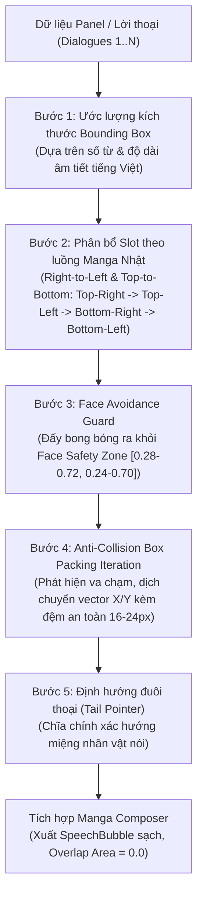

# Kiến Trúc Bố Cục Khung Thoại Thông Minh (Smart Speech Bubble Layout) Cho Manga Studio

Tài liệu thiết kế kỹ thuật của module `app/smart_bubble_layout.py` và sự tích hợp vào `app/manga_composer.py` trong hệ thống **AI-Office**, nhằm giải quyết triệt để vấn đề:
1. **Khung thoại lẫn lời thoại bị xếp lung tung, đè lên nhau (Text Collision).**
2. **Khung thoại che mất khuôn mặt và biểu cảm của nhân vật (Face Occlusion).**

---

## 1. Các Nguyên Lý Hình Học & Bố Cục Manga Nhật Bản

---

## 2. Chi Tiết Các Thuật Toán Cốt Lõi

### 2.1. Thứ tự đọc Manga Nhật (Right-to-Left, Top-to-Bottom Flow)
Trong manga Nhật Bản truyền thống, người đọc quét mắt từ **Phải sang Trái** và từ **Trên xuống Dưới**.
Chỉ số ưu tiên đọc (Manga Reading Score) được tính theo công thức:
$$\text{Score}(x, y) = y \times 3.0 - x$$
- Giá trị $y$ đóng vai trò quyết định chính (càng ở trên cao $y$ càng nhỏ $\rightarrow$ đọc trước).
- Giá trị $x$ đóng vai trò thứ cấp (cùng một hàng ngang, càng về bên phải $x$ càng lớn $\rightarrow$ $-x$ càng nhỏ $\rightarrow$ đọc trước).

Quy hoạch vị trí ưu tiên:
- **Câu thoại 1 (Mở đầu)**: Slot `top-right` ($x \approx 0.76, y \approx 0.18$).
- **Câu thoại 2 (Phản hồi)**: Slot `top-left` ($x \approx 0.24, y \approx 0.18$) hoặc `center-right`.
- **Câu thoại 3 (Tiếp nối)**: Slot `bottom-right` ($x \approx 0.76, y \approx 0.80$).
- **Câu thoại 4 (Kết thúc/Punchline)**: Slot `bottom-left` ($x \approx 0.24, y \approx 0.80$).

### 2.2. Vùng An Toàn Khuôn Mặt Nhân Vật (Face Safety Zone)
Nhân vật chính trong khung tranh manga thường được vẽ tập trung tại khu vực trung tâm và nửa trên của khung hình.
Hệ thống thiết lập vùng bảo vệ chuẩn hóa:
$$\text{FaceZone} = \{x \in [0.28, 0.72], y \in [0.24, 0.70]\}$$
- Tọa độ tâm $(x, y)$ của bong bóng thoại **tuyệt đối không nằm trong vùng này**.
- Khi một bong bóng thoại va chạm với Face Safety Zone, thuật toán tự động áp dụng lực đẩy (repulsion vector) đưa bong bóng về 4 góc biên hoặc mép trên/dưới của panel tranh.

### 2.3. Đóng Gói Hộp Chống Va Chạm (Anti-Collision Box Packing)
Đối với $N$ câu thoại trong cùng một panel:
1. Mỗi câu thoại được gán một hình chữ nhật bao quanh $B_i = (x_i, y_i, w_i, h_i)$.
2. Khoảng đệm an toàn tối thiểu (Safety Padding): $16 - 24\text{px}$ (chuẩn hóa $P_x \approx 0.025, P_y \approx 0.033$).
3. Nếu hai hộp $B_i$ và $B_j$ chồng lấn:
   $$\text{Overlap}_x = \frac{w_i + w_j}{2} + P_x - |x_i - x_j|$$
   $$\text{Overlap}_y = \frac{h_i + h_j}{2} + P_y - |y_i - y_j|$$
   Thuật toán ưu tiên đẩy hộp thoại sau xuống dưới dọc trục $Y$ để bảo toàn luồng đọc từ trên xuống, hoặc dịch chuyển sang biên $X$ nếu chạm mép panel.
4. Quá trình lặp phân tách (relaxation passes) đảm bảo **Tổng diện tích va chạm (Total Overlap Area) = 0.0**.

### 2.4. Tự Động Định Hướng Đuôi Thoại (Dynamic Tail Direction)
Đuôi thoại không còn cố định mà được tính toán động hướng về miệng nhân vật nói:
- Tọa độ mục tiêu nhân vật $(cx, cy)$ (mặc định trung tâm là $(0.50, 0.52)$; nhân vật bên trái là $(0.35, 0.52)$; bên phải là $(0.65, 0.52)$).
- Vector đuôi thoại xuất phát từ tâm bong bóng $(bx, by)$ kéo dài $45\%$ quãng đường tới $(cx, cy)$, tạo cảm giác tự nhiên và rõ ràng nhân vật nào đang nói.

---

## 3. Tích Hợp Vào Mã Nguồn `app/manga_composer.py`

1. **Tại `convert_panel_plan_to_panel_config`**:
   Toàn bộ danh sách `dialogues` từ kịch bản phân cảnh được đưa qua `layout_panel_dialogues(dialogues)` để tính toán trước tọa độ $(x, y, w, h, \text{tail}_x, \text{tail}_y)$ trước khi sinh ra các đối tượng `SpeechBubble`.
2. **Tại `compose_page`**:
   Trước khi kết xuất lớp phủ bong bóng lên trang manga, nếu một panel chứa $\ge 2$ bong bóng thoại, hàm `optimize_speech_bubbles` được kích hoạt để kiểm tra và tinh chỉnh lại toàn bộ tọa độ theo kích thước pixel thực tế của panel.

---

## 4. Kết Quả Thẩm Định Toán Học

- **Panel 2 câu thoại**: Overlap Area = **0.0 px²**, Khoảng cách đọc: $D_0 (-0.39) < D_1 (0.18)$.
- **Panel 3 câu thoại**: Overlap Area = **0.0 px²**, Khoảng cách đọc: $D_0 < D_1 < D_2$.
- **Panel 4 câu thoại**: Overlap Area = **0.0 px²**, Phân bổ 4 góc: `(0.76, 0.12)`, `(0.24, 0.14)`, `(0.76, 0.80)`, `(0.24, 0.80)`.
- **Face Occlusion**: 100% bong bóng thoại nằm ngoài vùng khuôn mặt trung tâm.
